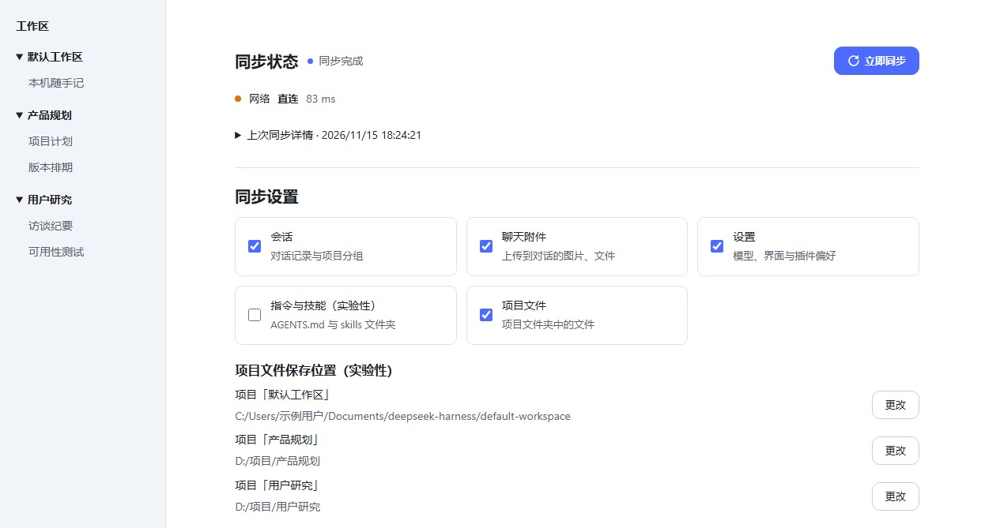

# ChatSync

ChatSync 是 [DeepSeek Harness(DSH)](https://github.com/deepseek-ai/deepseek-harness) 的多设备同步插件。把常用的会话、附件、项目分组和文件夹同步到另一台电脑，在原来的项目里接着工作。

数据存放在你自己的私有 Git 仓库。可以使用 GitHub 默认仓库，也可以连接 Gitee、GitLab 等托管站上的已有私有仓库。

*同步后的工作区与设置页，使用示例数据。*

## 安装与首次同步

需要 **DSH 0.2.0-rc.1 或更新版**和 **Git**。支持 DSH 网页端及 Windows、macOS 桌面端。GitHub 仓库还需要 GitHub CLI。

1. **安装。** 在 DSH 打开「插件 → 添加插件」，搜索 `chatsync`，安装后重新打开 DSH。已安装 `@dpskk2/dsh-chatsync` 的用户可沿用原包名更新。
2. **连接并同步。** 从侧栏打开「同步」，按页内提示连接私有仓库，再勾选要同步的内容并点「立即同步」。
3. **换台电脑。** 安装 ChatSync，连接同一个仓库并同步，即可取回已同步的内容。不同电脑的项目目录可在「同步设置」中调整。

[安装与换机指南](https://github.com/dpskk2/dsh-chatsync/blob/main/docs/getting-started.md) · [查看版本与下载安装包](https://github.com/dpskk2/dsh-chatsync/releases/latest)

## 可以同步什么

| 内容 | 同步范围 |
| --- | --- |
| 会话与聊天附件 | 对话记录、项目归属、聊天中上传的图片和文件 |
| 设置 | 支持共享的模型、界面和插件偏好 |
| 项目文件 | 项目目录中的文档、代码等文件，支持指定每台电脑的保存位置 |
| 指令与技能（实验性） | 可选同步全局 `AGENTS.md` 和 `skills/` 文件夹 |

每类内容可单独选择。模型密钥、代理和本机路径配置保留在各自电脑上。Windows 与 macOS 混用时，原会话的工作目录可能影响打开或续聊。[完整同步范围](https://github.com/dpskk2/dsh-chatsync/blob/main/docs/sync-content.md) · [跨系统换机说明](https://github.com/dpskk2/dsh-chatsync/blob/main/docs/getting-started.md#4-换台电脑接着使用)

## 日常使用

- **手动或自动同步。** 随时点「立即同步」。在「插件」里打开已安装的「同步」详情可切换自动同步和侧边栏入口。启动和退出时是否同步，可在「同步设置」里分别选择。
- **处理会话冲突。** 两台电脑各自向同一会话新增消息时，可并排查看差异、保留两个版本，或只保留当前版本。另存的会话由 DSH 写入并核对项目归属，项目登记失败时可以重试。舍弃的版本可在「历史冲突会话备份」中查看。
- **查看存储与恢复记录。** 在「管理存储」查看同步仓库、本机存储和同步前留存的原件。

[配置与恢复](https://github.com/dpskk2/dsh-chatsync/blob/main/docs/configuration.md) · [本机存储](https://github.com/dpskk2/dsh-chatsync/blob/main/docs/local-storage.md) · [反馈问题](https://github.com/dpskk2/dsh-chatsync/issues)
